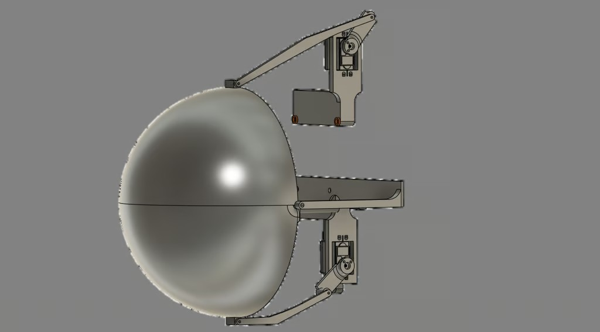
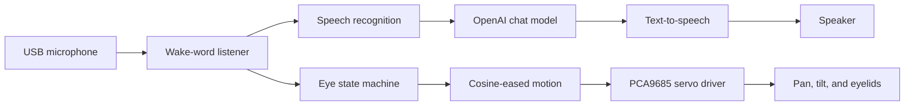
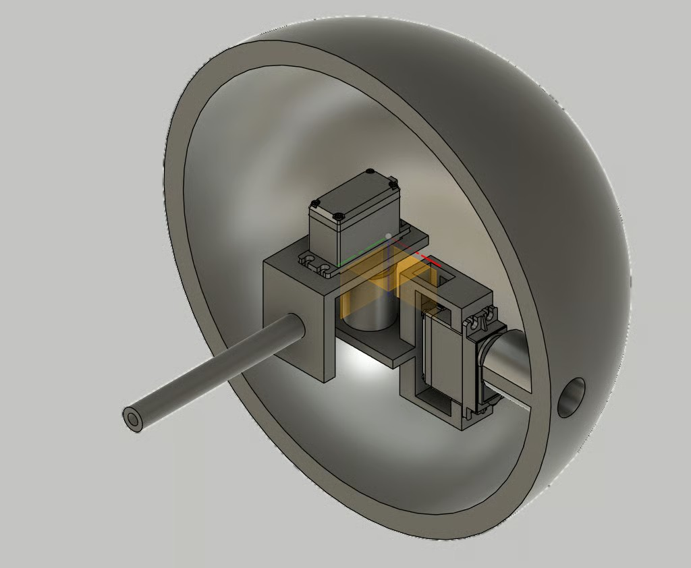
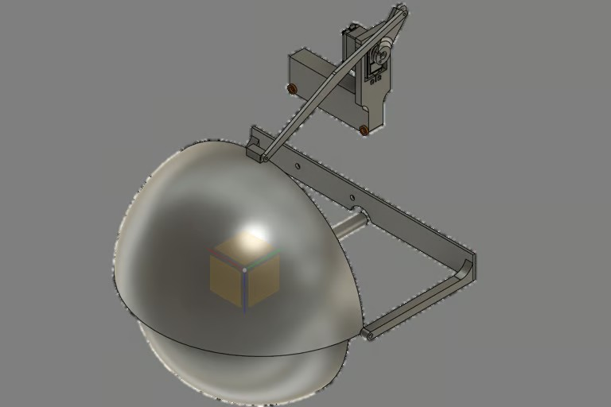

<div align="center">

# Animatronic AI Eye

**A monitor-arm-mounted robotic eye that listens, thinks, speaks, looks around, and blinks.**

[](https://angelojamesny.com/eye)
[](#software-setup)
[](#control-map)
[](cad/)



[Portfolio write-up](https://angelojamesny.com/eye) · [GrabCAD model](https://grabcad.com/library/eye-animatronic-1) · [CAD file](cad/Perfect%20circle%20200%20test%20v9.step) · [Demo videos](docs/demos.md)

</div>

## Overview

This project combines a four-servo animatronic eye with a voice-activated AI assistant. A Raspberry Pi listens for a custom wake phrase, transcribes speech, sends the prompt to an OpenAI model, and speaks the response while the eye transitions between sleeping, listening, and conversational movement.

The mechanism hides the pan and tilt servos inside the eyeball. Two more servos drive linked upper and lower eyelids, and the full assembly attaches to a spare monitor arm. Cosine-based easing softens servo starts and stops so the motion feels more organic and creates less mechanical noise near the microphone.

## Highlights

- Two-axis eye movement with randomized idle motion
- Independently driven eyelids and synchronized blinking
- Wake-word activation and conversational speech recognition
- Spoken AI responses using Google Text-to-Speech
- Voice interruption support while the assistant is talking
- PCA9685-based PWM control for four servos
- Printable/editable STEP assembly included in the repository

## How it works



The checked-in controller currently uses the wake phrase `hey hey`. While idle, the lids remain closed and the eye is centered. Waking opens the eye, performs a double blink, and starts randomized movement while the conversation is active.

## Hardware

The project was built around:

- Raspberry Pi with I²C enabled
- PCA9685 16-channel servo driver at address `0x40`
- Four hobby servos: horizontal, vertical, and two eyelids
- USB microphone (the script prefers devices containing `TKGOU` or `USB`)
- Speaker or audio output supported by Pygame
- Separately powered servo rail with a common ground to the Raspberry Pi
- 3D-printed eye, eyelid linkages, mounting parts, and a spare monitor arm

> [!CAUTION]
> Servo limits are specific to this build. Disconnect the linkages or remove servo power before running a calibration script for the first time. Never power multiple servos directly from the Raspberry Pi's 5 V rail.

## Control map

| PCA9685 channel | Function | Current range / state |
| ---: | --- | --- |
| `0` | Horizontal eye motion | `30°–140°`, center `90°` |
| `1` | Vertical eye motion | `80°–90°`, center `85°` |
| `2` | Eyelid servo A | open `170°`, closed `100°` |
| `15` | Eyelid servo B | open `0°`, closed `80°` |

See [Build and calibration notes](docs/build-notes.md) before adapting these values to another mechanism.

## Software setup

The software targets a Raspberry Pi running Python 3. System packages are needed for I²C and audio:

```bash
sudo apt update
sudo apt install -y python3-pip python3-smbus python3-pyaudio portaudio19-dev libsdl2-mixer-2.0-0
sudo raspi-config  # Interface Options -> I2C -> Enable
```

Create an environment that can still see the Pi's system `smbus` package, then install the Python dependencies:

```bash
python3 -m venv .venv --system-site-packages
source .venv/bin/activate
python -m pip install --upgrade pip
python -m pip install -r requirements.txt
```

Set the API key in the environment and start the assistant:

```bash
export OPENAI_API_KEY="your-key-here"
python software/eye_assistant.py
```

The program intentionally keeps credentials out of source control. If the microphone is not detected, adjust `get_correct_input_device()` in [`software/eye_assistant.py`](software/eye_assistant.py) to match the name reported by PyAudio.

## Mechanical design

| Internal eye mechanism | Upper-eyelid linkage | Complete eyelid system |
| --- | --- | --- |
|  |  |  |

The horizontal servo rotates the vertical-servo mount, producing two-axis motion while keeping both actuators inside the eye. The upper eyelid linkage was reinforced after an early pivot failed during testing. The lower lid uses a thicker pivot, a longer linkage, and a relief slot so both lids can share the same pivot area without colliding.

## Repository map

```text
.
├── assets/                         # Project renders used by the docs
├── cad/                            # Original STEP assembly + CAD notes
├── docs/                           # Build notes and demo index
├── software/
│   ├── eye_assistant.py            # Latest integrated controller
│   ├── calibration/                # Servo range test
│   └── prototypes/                 # Preserved development iterations
├── requirements.txt
└── README.md
```

The prototype scripts are preserved for project history. New work should start from [`software/eye_assistant.py`](software/eye_assistant.py).

## Project sources

- Original project story and build progression: [angelojamesny.com/eye](https://angelojamesny.com/eye)
- Original CAD publication: [GrabCAD — Eye animatronic](https://grabcad.com/library/eye-animatronic-1)
- CAD author: Angelo Demetroulakos; uploaded April 21, 2025

The source pages do not specify an open-source license. The files are collected here as the project owner's own portfolio archive; no additional license is implied.

