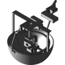

# Animatronic AI Eye CAD

### Complete mechanical assembly, servo linkages, and monitor-arm mount

<picture>
  
</picture>

This directory contains the original STEP model for the four-servo animatronic eye mechanism and mounting assembly.

<strong>Quick navigation:</strong> 
[Download Model](#included-model) | [Design Overview](#design-overview) | [Fabrication Notes](#fabrication-notes) | [Back to AI Eye](../)

---

## Included Model

| File | Format | File Size | Description | Download |
| --- | --- | ---: | --- | :---: |
| `Perfect circle 200 test v9.step` | STEP (AP214) | ~4.0 MiB | Full eyeball, pan/tilt gimbal, upper & lower eyelid linkages, and monitor arm clamp | [Download STEP](Perfect%20circle%20200%20test%20v9.step) |

## Design Overview

| Subsystem | Configuration |
| --- | --- |
| Eye mechanism | Internal pan and tilt micro-servos |
| Eyelid actuation | Two independent servo-driven linkages |
| Mounting interface | Standard VESA / monitor arm clamp bracket |
| Fabrication process | FDM 3D printing |
| Original publication | [GrabCAD — Eye animatronic](https://grabcad.com/library/eye-animatronic-1) |

## Fabrication Notes

> [!TIP]
> Verify dimensions, clearances, servo spline geometry, and print orientation in your CAD package before fabrication. Use heat-resistant filament (PETG/ABS/ASA) if operating near high-power servos or warm electronics.

The CAD is licensed under the repository's [Creative Commons Attribution 4.0 International License](../LICENSE). Reuse and modification, including commercial use, are permitted with attribution.

---

Designed and documented for **[Animatronic AI Eye](../)**.

